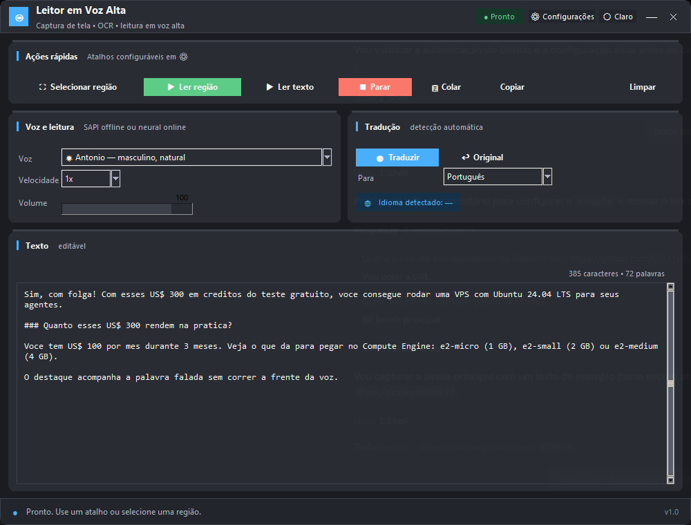

# Leitor em Voz Alta

Aplicativo Windows inspirado no fluxo do [MORT](https://github.com/kmonkeyhead/MORT), mas com outro objetivo: **em vez de traduzir em overlay**, ele seleciona uma área da tela, reconhece o texto e **lê em voz alta**. A interface usa um painel em cartões com acento azul do Windows 11, cantos arredondados, sombra e estados visuais.

A seleção funciona como o **Marquee Selection do Windows**: você arrasta um retângulo - com **preenchimento azul translúcido**, **contorno azul sólido + tracejado branco animado ("formigas andando")**, **guias amarelas no cursor** e uma **etiqueta que acompanha o mouse com X/Y e tamanho em tempo real** - e **solta o mouse para ler** (como no MORT). O escurecimento fora da área é leve, para o texto continuar legível enquanto você escolhe. A **lupa de zoom fica fixa no canto superior direito** e pode ser removida ou redimensionada. Também é possível mover/redimensionar as alças e confirmar com `Enter`. A janela de controle é um painel em cartões, com acento azul do Windows 11 e **cantos arredondados de verdade na própria janela**, além da sombra.



## O que ele faz

- **Overlay** transparente para desenhar a região no estilo **marquee do Windows** (azul translúcido, borda tracejada animada, guias no cursor e etiqueta de posição/tamanho em tempo real), com **lupa 2x opcional no canto superior direito**. Cor, opacidade e tamanho da lupa são configuráveis na aba **Seleção**.
- **OCR nativo do Windows** — funciona offline, sem chave de API e sem instalar Tesseract. A imagem da região é ampliada e nitidificada sem perder acentos ou confundir letras finas (`também`, `ideal`).
- **Leitura em voz alta** com voz neural pt-BR natural (`Thalita Neural`, padrão) usando `edge-tts`, ou com vozes SAPI offline do Windows (`Microsoft Maria Desktop`, `Zira` etc.). O áudio neural segue em **decoder único e contínuo**: cada bloco curto é baixado por completo enquanto o anterior toca, para não aparecerem buracos quando o serviço demora. Textos muito grandes são **lidos até o fim**, sem descartar áudio quando a fila enche.
- A lista de vozes mostra nomes amigáveis (Thalita, Francisca, Antonio); o ID exato fica salvo em `dados/config.json`.
- **Botão Traduzir**: detecta o idioma do texto e traduz para **27 idiomas** (português, inglês, espanhol, francês, alemão, japonês, coreano, chinês, russo, árabe, hindi etc.), já lendo a tradução em voz alta.
- Controles de **velocidade**, **volume**, **pausar/continuar**, **parar**, **copiar texto**, **📋 colar texto**, **voltar ao original**, botão **⚙ Configurações** e botão **🌙 Escuro / ☀ Claro** na barra (preferência salva no `config.json`). O tema cobre a janela inteira, incluindo a janela de configurações; no modo escuro a fonte é branca. As cores são canônicas por paleta, então o tema também fica correto **desde a primeira abertura**, tanto no claro quanto no escuro.
- **Atalhos globais configuráveis** em **⚙ Configurações** (clique no atalho e pressione a nova combinação).
- **Minimizar** pelo botão `—`: a janela vai para a **barra de tarefas como um aplicativo normal** e a **leitura continua em segundo plano**. Restaura clicando no ícone da barra ou com `Ctrl+Shift+M` (há um botão 🔊 de contingência se o Windows não registrar o ícone).
- A janela **não fica sempre na frente** dos outros programas por padrão; quando você seleciona texto em outro app, ela volta para **trás da janela ativa**. Se quiser o contrário, ative "Manter janela sempre no topo" em **⚙ Configurações**.
- Texto do OCR **substitui** o painel por padrão (sem precisar clicar em Limpar). Quem quiser acumular, ative "Manter texto anterior" nas configurações.
- A janela abre em **1000×760** e a caixa de texto é maior (editável, com rolagem). O áudio é pré-carregado antes de iniciar a saída e mantém um buffer de ~15 s para evitar travadas no início e no meio da leitura.
- **Limpar** descarta junto o texto do painel e todo o áudio temporário/cache em memória — não sobra MP3 em disco.
- Configurações salvas em `dados/config.json`.

## Requisitos

Para usar o instalador:

- Windows 10 ou 11 (o instalador é por usuário e não pede administrador).
- Pacote de idioma de OCR `pt-BR` instalado (o Windows 11 já costuma trazer; o app verifica na abertura das configurações).
- Internet apenas para a voz neural e a tradução. O OCR e as vozes SAPI funcionam offline.

Para rodar a partir do código:

- Python 3.10+ e os pacotes de `requirements.txt`.
- `ffmpeg` no PATH (ou o `ffmpeg.exe` ao lado de `main.py`) para a voz neural.

## Instalação

Baixe o instalador na última versão publicada: **[LeitorVozAlta-Setup.exe](https://github.com/Marcosvx96/Leitor-e-Tradutor-de-Tela-/releases/latest/download/LeitorVozAlta-Setup.exe)** (ou em **[Releases](https://github.com/Marcosvx96/Leitor-e-Tradutor-de-Tela-/releases)**) e dê dois cliques. O instalador:

- instala o aplicativo e o `ffmpeg` em `%LOCALAPPDATA%\Programs\Leitor em Voz Alta`;
- cria o atalho no Menu Iniciar e, se você marcara a opção, na Área de Trabalho;
- registra desinstalação em **Configurações > Aplicativos**.

Não é preciso ter Python instalado na máquina. Para gerar o instalador a partir deste repositório, veja **Gerando o instalador** abaixo.

## Como rodar a partir do código

O comando abaixo usa o ambiente virtual já existente na pasta do projeto.

Dê dois cliques em **`Leitor em Voz Alta.lnk`** (está na pasta do projeto e também na Área de Trabalho). Ele abre o app com seu próprio ícone e **sem janela de console**.

Também funciona com `executar.vbs` (inicializador silencioso) ou `executar.bat` (compatibilidade).

Ou, pelo terminal, dentro desta pasta:

```powershell
.\.venv\Scripts\pythonw.exe main.py
```

> Se precisar ver mensagens de erro no terminal, use `python.exe` no lugar de `pythonw.exe`. O próprio `main.py` chama `FreeConsole()` para esconder o cmd mesmo quando iniciado com `python.exe`. O `ffmpeg` da voz neural também é iniciado sem janela de console.

Para recriar o ambiente, caso ele seja apagado:

```powershell
python -m venv .venv
.\.venv\Scripts\python -m pip install -r requirements.txt
```

## Como usar

1. Clique em **⛶ Selecionar região** (ou `Ctrl+Shift+S`). A janela principal some e a tela fica escurecida.
2. Arraste o mouse sobre o texto que quer ouvir e **solte**: a leitura começa na hora. Se preferir ajustar antes, use as alças e confirme com `Enter`, duplo clique ou **Ler**.
3. O texto reconhecido **substitui** o painel e começa a ser lido automaticamente. A janela volta **atrás do aplicativo que estava ativo** para não atrapalhar. A palavra que está sendo falada fica destacada no painel e o texto rola junto até o final da leitura.
4. Use **Pausar/Continuar**, **Parar**, **Ler texto**, **📋 Colar**, **Copiar** ou **Limpar** conforme precisar. **Colar** traz para o painel o texto que já está na área de transferência. O botão **🌙 Escuro / ☀ Claro** na barra alterna o tema de toda a interface.
5. Também é possível digitar um texto diretamente no painel e clicar em **▶ Ler texto** - ele lê exatamente o que está no painel, sem precisar de OCR.
6. O botão `—` minimiza para a barra de tarefas; clique no ícone do app na barra ou use `Ctrl+Shift+M` para restaurar.

Cada clique em **⛶ Selecionar região** começa uma seleção nova: a região anterior **não aparece** na tela. A região escolhida fica salva para `Ctrl+Shift+L` capturar e ler a mesma área novamente. Tudo isso pode ser alterado em **⚙ Configurações**.

### Personalizando a seleção

Abra **⚙ Configurações > aba Seleção** para ajustar o marquee:

- **Mostrar lupa de zoom** — desmarque para remover a lupa da tela.
- **Largura da lupa** e **Altura da lupa** — de 200–800 px por 120–500 px.
- **Opacidade da área** — de 5% a 100% (padrão 45%); o texto por baixo continua legível.
- **Cor da área** — digite um código `#RRGGBB` ou use **Escolher cor**. A cor vale para o preenchimento, a borda e o título da lupa.

A lupa aparece no **canto superior direito**, não acompanha o mouse e só é exibida a partir do primeiro arraste — assim ela nunca cobre a área que você está escolhendo.

### Personalizando o destaque da leitura

Abra **⚙ Configurações > aba Leitura** para ajustar a marcação da palavra falada no painel:

- **Opacidade do destaque** — de 5% a 100% (padrão 70%). A cor é misturada com o fundo do painel, então o texto continua legível.
- **Cor do destaque** — digite um código `#RRGGBB` ou use **Escolher cor** (padrão `#CCE4FB`). Há uma prévia da cor na própria janela.

O destaque começa junto com a narração, mesmo em textos longos: os marcadores iniciais são estimados e substituídos pelos limites por palavra que o narrador informa. A marcação só é pintada quando casa com a próxima palavra do painel, para não aparecer em outra ocorrência sem relação. Em palavras longas, o destaque espera o fim da palavra antes de trocar (no máximo 1,5 s, para não travar), e o tempo dos blocos seguintes é ajustado pelo áudio real para não correr à frente da voz. As alterações são aplicadas na hora em que você salva e continuam valendo depois de trocar o tema.

### Atalhos

| Atalho | Ação |
| --- | --- |
| `Ctrl + Shift + S` | Selecionar região |
| `Ctrl + Shift + L` | Capturar e ler a região atual |
| `Ctrl + Shift + P` | Parar a leitura |
| `Ctrl + Shift + C` | Copiar o texto reconhecido |
| `Ctrl + Shift + T` | Traduzir o texto para o idioma escolhido |
| `Ctrl + Shift + M` | Mostrar/restaurar a janela |
| `Enter` / duplo clique / soltar mouse | Confirmar a seleção |
| `Esc` ou botão direito | Cancelar a seleção |
| `Delete` | Limpar a seleção atual |

Todos os atalhos acima podem ser alterados: abra **⚙ Configurações**, clique no atalho desejado e pressione a combinação nova (`Esc` cancela a gravação). O botão mostra o nome real da tecla — `F12`, `Page Up`, setas etc. — em vez do código interno do Windows.

### Traduzindo

No cartão **Tradução**:

1. Escolha o idioma de destino em **Para** (português é o padrão).
2. Clique em **🌐 Traduzir** (ou `Ctrl+Shift+T`). O idioma de origem é detectado automaticamente.
3. Se o texto estiver em inglês, por exemplo, ele aparece traduzido no painel e a tradução é lida em voz alta.
4. **↩ Original** restaura o texto reconhecido antes da tradução.

Em **⚙ Configurações** você pode ativar **Traduzir automaticamente se o idioma for outro**. A tradução usa `deep-translator` (MyMemory, com fallback para Google), sem chave de API — portanto **requer internet**. A detecção do idioma é local e funciona offline.

### Escolhendo a voz

Por padrão o app usa **🌟 Thalita — feminina, natural (multilíngue)** (`pt-BR-ThalitaMultilingualNeural`), a voz pt-BR mais natural disponível no `edge-tts`. Também estão disponíveis **Thalita**, **Francisca** e **Antonio** (masculina). Para funcionar 100% offline, escolha uma voz SAPI na mesma lista (por exemplo, `Microsoft Maria Desktop`); em **⚙ Configurações > Voz neural** você troca a voz neural sem mexer na SAPI.

> A voz neural envia o texto para o serviço de síntese da Microsoft, mas **não espera a geração terminar**: cada frame MP3 recebido alimenta um único `ffmpeg`, que devolve áudio PCM contínuo para a placa de som. Não existe mais um arquivo por frase — por isso a leitura ficou fluida, sem o engaso que ocorria quando o player reiniciava o decoder. O primeiro som costuma aparecer em 1–2 s. O status mostra "Sintetizando voz neural..." no início e "Reproduzindo voz neural..." quando o áudio entra. Releitura idêntica sai do **cache em memória** (sem rede e sem gravar em disco); **Limpar** apaga esse cache. Erros transitórios ("No audio was received") são repetidos e podem trocar para outra voz pt-BR antes de desistir. Se nada funcionar, o app **cai automaticamente para a voz SAPI local** e avisa no status — você nunca fica sem áudio. Se preferir funcionar 100% offline, mantenha uma voz SAPI selecionada.

Antes de sintetizar, o app remove do texto lido (sem alterar o painel) sujeira como `***`, `###`, `@@`, aspas, parênteses, marcadores de lista e linhas de separadores, deixando a narração mais natural.

## Estrutura

```text
.
├── main.py                 # ponto de entrada (esconde o console no Windows)
├── icone.ico               # ícone do app e do atalho
├── Leitor em Voz Alta.lnk  # atalho sem console, com ícone (como um .exe)
├── executar.vbs            # inicializador silencioso
├── executar.bat            # compatibilidade (chama o .vbs)
├── requirements.txt
├── leitor_em_voz_alta/
│   ├── app.py              # janela flutuante e orquestração
│   ├── selecao.py          # overlay de seleção + lupa de zoom
│   ├── captura.py          # captura de tela (mss)
│   ├── ocr.py              # OCR nativo do Windows via winrt
│   ├── fala.py             # SAPI (offline) e edge-tts (online)
│   ├── traducao.py         # detecção de idioma e tradução (27 idiomas)
│   ├── atalhos.py          # normalização/validação dos atalhos (pynput)
│   └── config.py           # config.json em dados/
├── instalador/             # script e configuração do instalador Windows
│   ├── gerar_instalador.py
│   ├── gerar_instalador.bat
│   └── setup.iss
└── testes/                 # checagem de ambiente e OCR
```

## Gerando o instalador

Ferramentas necessárias no Windows:

```powershell
python -m venv .venv
.\.venv\Scripts\python -m pip install -r requirements.txt
.\.venv\Scripts\python -m pip install pyinstaller
winget install --id JRSoftware.InnoSetup --source winget
```

Depois, dê dois cliques em `instalador\gerar_instalador.bat` (ou execute o `.py` com o Python do `.venv`). O script:

1. gera `dist\LeitorVozAlta` com o PyInstaller;
2. copia o `ffmpeg.exe` da máquina para dentro do pacote;
3. compila o instalador em `instalador\Output\LeitorVozAlta-Setup.exe`.

O `ffmpeg` precisa estar no PATH ou em `C:\ffmpeg\bin`. As pastas `build`, `dist` e `instalador\Output` são ignoradas pelo Git.

## Verificação rápida

```powershell
.\.venv\Scripts\python.exe testes\verificar.py
```

O script confirma idiomas de OCR, vozes disponíveis, tradução (en → pt) e faz um OCR de teste em uma imagem gerada dentro de `referencias/`. Para testar a interface, seleção, tradução, atalhos, minimizar e o fluxo completo, rode também:

```powershell
.\.venv\Scripts\python.exe testes\smoke_ui.py
.\.venv\Scripts\python.exe testes\smoke_selecao.py
.\.venv\Scripts\python.exe testes\smoke_traducao.py
.\.venv\Scripts\python.exe testes\smoke_recursos.py
```

> Os testes `smoke_*` criam uma instância real da janela e podem alterar `dados/config.json`. Restaure o arquivo se quiser voltar aos valores padrão.

## Solução de problemas

- **"Nenhum motor OCR disponível"**: instale o idioma em `Configurações > Idiomas e região` no Windows e reinicie o app.
- **Não reconhece bem o texto**: aumente a região, mantenha "Melhorar imagem antes do OCR" ativado e evite janelas com transparência. A preparação agora amplia pelo menos 2x e nitidifica sem binarizar, preservando acentos e letras como `m`/`i`.
- **A voz neural demora ou falha**: o primeiro som costuma começar em 1–2 s; a leitura segue em fluxo contínuo. A reprodução neural contínua usa `ffmpeg` (já presente neste computador) e `sounddevice`; se faltar, o app avisa e cai para a voz SAPI local (Maria/Zira). Para garantir offline, selecione uma voz SAPI na lista.
- **A tradução falha**: ela precisa de internet (MyMemory/Google); o OCR e a detecção de idioma continuam funcionando offline.
- **Seleção não aparece**: some a janela principal e use `Ctrl+Shift+S`; em alguns apps em tela cheia, use o modo de janela/borderless.
